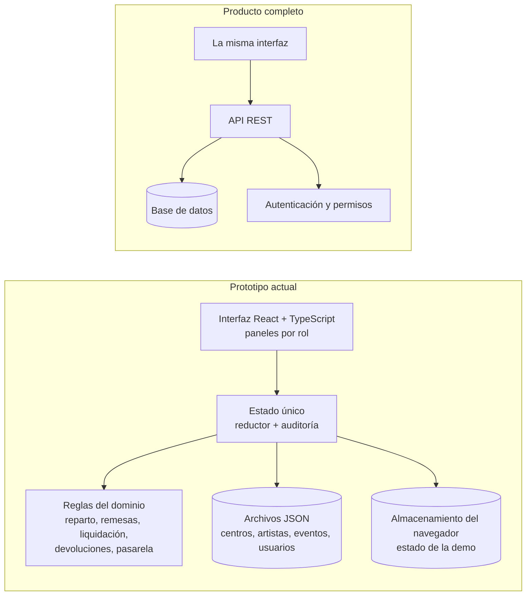

<div align="center">
  <picture>
    <source media="(prefers-color-scheme: dark)" srcset="./public/logo-urbana-cult-claro.svg">
    
  </picture>

  # Urbana Cult · Prototipo de la plataforma
</div>

Demostración navegable de **Urbana Cult**, una red de 25 centros culturales independientes con
una cartelera única, venta de entradas sin sobreventa y un reparto automático de cada cobro entre
el centro, el artista y la red. Muestra, de punta a punta, cómo se mueve el dinero de una entrada:
desde la compra hasta la liquidación a D+2.

> **Esto es una demostración, no el producto final.** Se hizo para presentar el proyecto de
> Ingeniería de Software. Todos los datos son ficticios y el estado vive en el navegador, sin
> servidor. El análisis, el diseño y los requerimientos están en la documentación del proyecto y en
> la sección **Proyecto** del propio sitio; acá solo está lo necesario para probarlo y correrlo.


**Demo en línea:** https://mdev-repos.github.io/prototipo_urbana_cult_proyecto_tecnicatura/ ·
**Guía de la demostración (PDF):** [`docs/Guia-de-la-demostracion.pdf`](./docs/Guia-de-la-demostracion.pdf)

---

## Índice

- [Qué se puede ver](#qué-se-puede-ver)
- [Recorrido de uso](#recorrido-de-uso)
- [Cuentas de la demostración](#cuentas-de-la-demostración)
- [Arquitectura](#arquitectura)
- [Tecnologías](#tecnologías)
- [Estructura del proyecto](#estructura-del-proyecto)
- [Cómo correrlo en local](#cómo-correrlo-en-local)
- [Del prototipo al producto](#del-prototipo-al-producto)
- [Alcances y límites](#alcances-y-límites)
- [Equipo](#equipo)

---

## Qué se puede ver

El sitio tiene tres secciones: **Equipo**, **Proyecto** (la materia, la consigna y un resumen de las
decisiones de diseño) y **MVP**, el prototipo en sí, con seis roles y un panel para cada uno:

- **Cliente final**: cartelera con cupos en vivo, compra con reserva que vence, entradas con QR y pedido de devolución.
- **Vendedor del centro**: vende solo los eventos de su centro, en efectivo o con medio electrónico, y cierra la caja del día.
- **Admin del centro**: publica, modifica y da de baja eventos, genera las remesas del efectivo y ve su estado de cuenta.
- **Artista**: consulta sus funciones, la ocupación y su parte; es una vista de solo lectura.
- **Admin de plataforma**: gestiona usuarios, roles y centros, y consulta avisos y auditoría. No puede aprobar ni ejecutar pagos.
- **Coordinación Central**: Administración General aprueba la liquidación y Boletería y Cobros la ejecuta, concilia remesas y pasarela y resuelve incidencias; ambas ven el libro mayor y el fondo de contingencia.

La barra superior de la demo tiene un **reloj simulado** (`+1 día`, `+7 días`) para llegar a las
fechas de liquidación, y un botón **Reiniciar** que vuelve todo al estado inicial.

## Recorrido de uso

1. **Un cliente compra** 2 entradas: se reserva el cupo, paga y recibe sus entradas. El pago queda **asentado y retenido** en el libro mayor: centro, artista y Urbana.
2. **Un vendedor cobra en efectivo** en la boletería y cierra la caja con una diferencia, que abre una incidencia.
3. **El admin del centro remesa** el efectivo con una referencia única.
4. **Se avanza la fecha** hasta D+2 del evento. Administración General **aprueba** la liquidación y Boletería y Cobros la **ejecuta**: el dinero pasa de retenido a pagado.
5. **Si algo sale mal**, hay un camino para cada caso: un centro que no remesa se bloquea y el fondo cubre al artista; un reclamo se resuelve con una reversión prorrateada; la pasarela puede informar un cobro dos veces.

El recorrido completo, con capturas, está en la [guía en PDF](./docs/Guia-de-la-demostracion.pdf).

## Cuentas de la demostración

La contraseña de todas es `demo`. En la pantalla de ingreso también hay un desplegable
**“o ingresá como”** para entrar con un toque.

| Rol | Email |
|---|---|
| Cliente final | `lucia@demo.urbana` |
| Vendedor del centro | `nahuel@demo.urbana` |
| Admin del centro | `maria@demo.urbana` |
| Artista | `marga@demo.urbana` |
| Admin de plataforma | `tomas@demo.urbana` |
| Coordinación · Administración General | `carolina@demo.urbana` |
| Coordinación · Boletería y Cobros | `diego@demo.urbana` |

## Arquitectura

Es una aplicación web de una sola página (SPA). Las reglas de negocio viven en funciones puras,
separadas de las pantallas, y todo el estado pasa por un único reductor, así que cada acción
(vender, remesar, liquidar, devolver) se valida en un solo lugar y deja su registro de auditoría.



- **El dinero se maneja en centavos enteros**, y el reparto de cada cobro se calcula con una regla única de redondeo.
- **El libro mayor no se edita**: las devoluciones agregan asientos de reversión prorrateados y cada venta se controla contra sus asientos (débitos = créditos).
- **Las rutas están protegidas por rol**: cada rol aterriza en su panel y no puede abrir el de otro.

## Tecnologías

| Categoría | Herramienta | Para qué |
|---|---|---|
| Interfaz | React 19 + TypeScript | Componentes tipados |
| Build | Vite | Desarrollo rápido y empaquetado |
| Rutas | React Router (con rutas por hash) | Navegación y protección por rol; funciona en GitHub Pages sin configuración |
| Entradas | qrcode.react | Código QR de cada entrada |
| Tipografía | JetBrains Mono (incluida en el proyecto) | Identidad visual, sin servicios externos |
| Calidad | oxlint + Prettier | Revisión y formato del código |
| Publicación | GitHub Actions + GitHub Pages | Sitio estático de demostración |

## Estructura del proyecto

```
src/
├── components/       # logo vectorial y selector de tema
├── layouts/          # cabecera y pie del sitio
├── pages/            # Equipo y Proyecto
├── data/             # datos del equipo
└── mvp/              # el prototipo
    ├── domain/       # reglas de negocio puras: reparto, remesas, liquidación, devoluciones, pasarela
    ├── data/         # datos de ejemplo en JSON: centros, artistas, eventos, usuarios, parámetros
    ├── components/   # modales, formularios, tarjetas y piezas compartidas
    ├── pages/        # un panel por rol, más la pantalla de ingreso
    ├── state.tsx     # estado único, reductor y auditoría
    └── types.ts      # modelos de datos
docs/                 # guía de la demostración (PDF)
```

## Cómo correrlo en local

**Prerrequisitos**: Node.js 20.19 o superior (o 22.12+).

```bash
npm install
npm run dev
```

La aplicación queda en `http://localhost:5173`. Otros comandos:

```bash
npm run build     # compila para producción (carpeta dist/)
npm run lint      # revisa el código
npm run preview   # sirve la versión compilada
```

La publicación en GitHub Pages es automática con cada cambio en `main`
(`.github/workflows/deploy.yml`); hay que activar **Settings → Pages → Source: GitHub Actions**.

## Del prototipo al producto

| Tema | En la demostración | En un producto real |
|---|---|---|
| Datos y usuarios | Ficticios, en el navegador | Servidor y base de datos; alta de usuarios y acceso seguro |
| Pagos | Pasarela simulada | Pasarela real con confirmaciones idempotentes y conciliación automática |
| Efectivo y liquidación | Remesas y pagos informados en pantalla | Transferencias bancarias conciliadas, con comprobantes |
| Fecha | Reloj simulado | Fecha real, con bloqueos y liquidaciones automáticos |
| Seguridad | Una contraseña de prueba | Segundo factor para roles sensibles y auditoría persistente |
| Parámetros | Comisión 10 %, fondo 2 %, plazo D+2: valores de ejemplo | Los define la Asamblea de representantes |

## Alcances y límites

- Los **datos son ficticios**: personas, centros, eventos y montos inventados para la demo.
- El **estado se guarda en el navegador**: cambiar de dispositivo o borrar los datos del sitio lo reinicia.
- Algunas situaciones están **simplificadas a propósito**: no hay una liquidación complementaria cuando un centro regulariza sus remesas después de liquidar, y no se puede reclamar una devolución una vez liquidado el evento.
- Los **valores de ejemplo** (comisión, aporte al fondo, plazo de remesa) no son decisiones reales de la red.

## Equipo

**Equipo 23 · Comisión A · IFTS N° 29 · Ingeniería de Software**
Docente: Ayelen Natalia Arias Gomez

| Integrante | Enlaces |
|---|---|
| Álvarez Márquez, Camila | — |
| Mazzitelli, Matías Nicolás | [GitHub](https://github.com/mdev-repos) · [LinkedIn](https://www.linkedin.com/in/mnm-dev) |
| Piedrabuena, Julián | [GitHub](https://github.com/juliganSW) |
| Savia, Martín Raúl | [GitHub](https://github.com/martin-2t) · [LinkedIn](https://www.linkedin.com/in/martin-savia-03840738a) |
| Valdez Montigel, Emmanuel Alejandro | [GitHub](https://github.com/Emmanuel-Valdez) · [LinkedIn](https://www.linkedin.com/in/evaldezdev/) · [Web](https://evaldez.ar/) |
